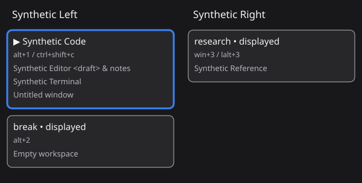

# GlazeWM Navigator

A personal Windows Raycast extension that takes a fresh GlazeWM snapshot when
opened and displays a visual workspace navigator. No local development toolchain
is required for cloud development and automated testing.



**The example above is entirely synthetic. Real Windows integration has not been
tested in the cloud.** This initial implementation needs desktop validation.

## Interaction

The **Navigate Workspaces** command presents monitor columns as an SVG diagram
inside Raycast's Detail view. Occupied workspaces and displayed empty workspaces
appear; other empty workspaces and monitors with nothing qualifying are hidden.
Windows inside nested containers are included. Monitor order follows desktop
coordinates from left to right; workspace order follows GlazeWM's runtime tree.

- **Alt+H / Alt+L**: previous / next monitor.
- **Alt+J / Alt+K**: next / previous workspace on that monitor.
- **Enter**: focus the highlighted workspace, then close Raycast after success.
- **Escape**: Raycast's native back/dismiss behavior leaves the command without
  sending a focus command. Whether it also closes the whole Raycast window
  depends on native navigation behavior/settings; the extension does not
  intercept Escape. **Dismiss Navigator** explicitly closes the window.
- **Configured workspace shortcuts**: where supported, immediately focus the
  corresponding visible workspace and close Raycast. Inspect registered actions
  in the action panel.

Only workspaces are targets. Navigation clamps at edges; changing monitors keeps
the row where possible. The initial highlight prefers the focused workspace,
then a displayed workspace. Moving the highlight never switches desktop focus.
Cards shorten long names and titles; the selected workspace's complete window
titles appear below the diagram. Close and reopen to take a fresh snapshot.

## Raycast API compatibility

Official documentation was checked before implementation. Raycast 2.0 supports
Windows extensions; this manifest declares Windows only. Detail provides Markdown
and images, rather than arbitrary HTML/CSS or native selectable monitor columns.
SVG images are documented as supported in Detail. The documented action shortcut
API uses modifiers; there is no documented raw H/J/K/L event handler for Detail.

The SVG diagram with **Alt+H/J/K/L** was explicitly approved for this project.
The diagram is an image: actions update its workspace highlight. Enter invokes
the primary action. See [official API findings and links](docs/raycast-feasibility.md).

## Architecture

- `src/navigate.tsx`: command lifecycle, Detail, keyboard actions, activation guard,
  and user-facing errors.
- `src/glazewm.ts`: production WebSocket adapter and read-only config discovery.
  Each request opens a short-lived connection to the official local default
  endpoint, `ws://127.0.0.1:6123`, sends a plain-text command, matches its
  `client_response`, then closes. Requests time out after four seconds.
- `src/model.ts`: runtime shape validation, hierarchy, recursive window collection,
  selection, and focus command generation.
- `src/config.ts`: conservative YAML binding extraction and config path resolution.
- `src/diagram.ts`: XML-escaped SVG generation and escaped Markdown titles.
- `tests/fixtures/synthetic.ts`: invented data used only by tests and the static
  documentation illustration, never imported by the production adapter.

Invocation requests `query monitors`, whose DTOs include workspaces and nested
windows. No subscriptions, polling, telemetry, or persistent state cache. Before
activation, another one-shot query checks that the workspace's runtime identity
still qualifies. The extension then sends
`command focus --container-id <workspace UUID>`. This targets a workspace, without
exposing window activation. Using its ID avoids quoting names or recreating a
vanished workspace. If it disappears in the final race before focus, GlazeWM's
error is shown and the navigator stays open.

Protocol and config precedence were checked against
[official GlazeWM source](https://github.com/glzr-io/glazewm/tree/5709ad0a3c7c386bbc3e38166a865ffc12937515):
`packages/wm-common/src/ipc.rs`, `app_command.rs`, `dtos/`,
`packages/wm/src/ipc_server.rs`, and `user_config.rs`.

### Configuration and shortcuts

The inspected protocol has no config-file query. On Windows, built-in PowerShell
`Get-CimInstance` reads the running `glazewm.exe` command line without executing
that command line. Config resolution follows:

1. Its explicit `--config` / `-c` argument, including quoted absolute paths.
2. The existing `GLAZEWM_CONFIG_PATH` inherited by Raycast.
3. GlazeWM's documented `.glzr/glazewm/config.yaml` under the current user's
   dynamically discovered home directory.

The file is read only, never created or modified. No personal path is embedded.
Multiple processes, inaccessible metadata, relative paths, invalid YAML, or a
missing file produce a visible shortcut warning; runtime navigation continues.
If GlazeWM and Raycast inherited different config environment values, the
extension cannot inspect the other process's environment. A file edited since
GlazeWM last loaded it may differ from active bindings. There is no automatic
config reload or mutation.

Only top-level bindings with exactly one `focus --workspace NAME` (or
`--workspace=NAME`) command supply labels and destinations. Command chains,
window-moving bindings, relative focus, binding modes, extra flags, and quoted
multiword destinations are excluded. The inspected GlazeWM command parser splits
on whitespace, so shell-style quoting is not assumed.

Labels preserve original modifiers. Action registration supports letters/digits
with exact `alt`, `ctrl`, `shift`, and `win` (`win` maps to Raycast's `windows`).
Side-specific modifiers, function keys, unmodified keys, duplicate combinations,
Alt+H/J/K/L, and Ctrl+K/R remain labels only. No modifiers are stripped or weakened.
Direct actions target only workspaces present in the filtered snapshot; hidden
empty workspaces stay hidden. A direct shortcut activates immediately. Labels
without registered actions are informational, rather than guaranteed hotkeys.

## Cloud development and tests

Use Node.js **22.22.2 or newer** and npm in cloud. Node 24 was used initially.
Dependencies are recorded in `package-lock.json`.

```sh
cd /workspace/glazewm-navigator
npm --cache /workspace/.npm-cache ci --no-fund
npm run check
```

Individual checks:

```sh
npm run typecheck
npm run lint
npm test
npm run build
```

Tests use Node's test runner through `tsx`. They cover filtering, hierarchy,
nested containers, selection, YAML/modifiers, config discovery, ID-based commands,
and disappearance/failure before activation. A local WebSocket server **simulates**
GlazeWM to exercise framing, response matching, successful activation, timeouts,
malformed JSON, server errors, and connection closure. These are synthetic tests,
not real Windows or GlazeWM integration.

`ray build` compiles on Linux without running Raycast. The CLI writes generated
files under `~/.config/raycast/extensions/glazewm-navigator` and may require
filesystem permission in a sandbox. Generated declarations are ignored.
`npm run dev` is for an eventual desktop development session, not cloud checks.
No cloud background service is required. Use the existing checkout directly;
a Git worktree is unnecessary.

## Eventual Windows validation

No desktop development toolchain is required **now**. When ready to test on the
actual desktop:

1. Use Raycast 2.0 or newer with Windows extensions and a running GlazeWM. Load
   this personal extension through Raycast's supported development/import
   workflow. That eventual workflow may require Windows Node/npm; a cloud build
   does not install the extension on your desktop. Nothing has been published.
2. Assign **Navigate Workspaces** a hotkey in Raycast's settings. The extension
   never creates or modifies system hotkeys.
3. Compare the diagram with real monitors, occupied/displayed-empty/hidden-empty
   workspaces, floating/minimized windows, and nested splits.
4. Check SVG/data-URI rendering in light/dark modes, scrolling, and selection.
   Many monitors scale down the image; tall workspaces require scrolling. There
   is no automatic scroll-to-selection or per-card accessibility focus. Selected
   workspace titles are also available as text below the image.
5. Verify Alt+H/J/K/L, Enter, Escape, and direct shortcuts on your keyboard.
   GlazeWM or Windows may intercept global combinations before Raycast receives
   them. The extension cannot override that or silently change the modifiers.
6. Confirm activation closes Raycast and leaves desktop focus on the expected
   workspace. Reopen for a fresh snapshot. Confirm Escape never switches
   workspace; check whether a second Escape closes the host window.
7. Stop GlazeWM and check the unavailable state. Remove a workspace after taking
   a snapshot: it should report an error, stay open, and never recreate it.
   Check standard and custom configuration paths.

No custom preferences, background helpers, window actions, browser integration,
thumbnails, YASB, or Zebar components are included.
